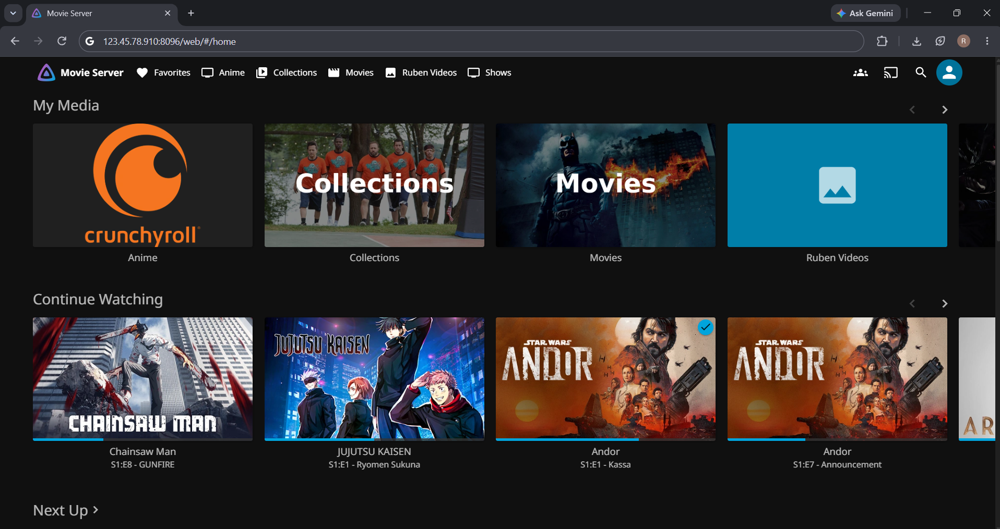
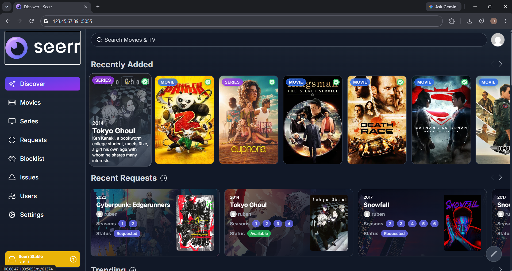
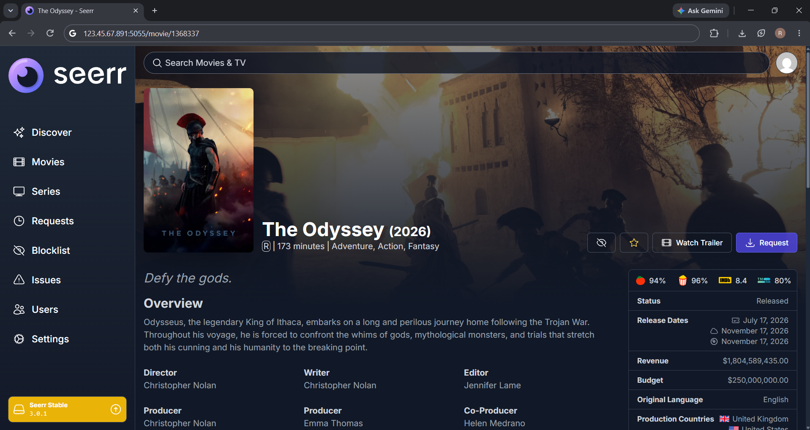
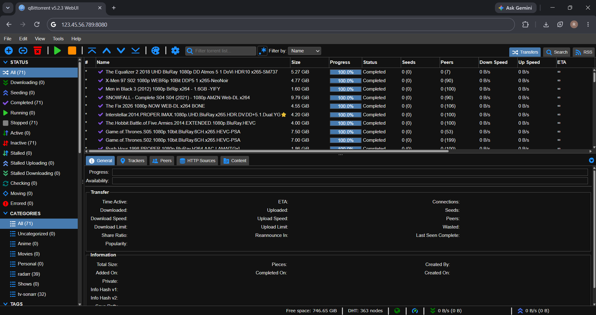

# Debian-Automated-Home-Server
Self-hosted media management and network infrastructure built using Debian Linux and Docker.

Project Overview

Designed and configured a home server to centralize media storage, automate media organization, provide remote connectivity, and host network services.

Technology Stack:
Debian Linux,
Docker,
Docker Compose,
Jellyfin,
Sonarr,
Radarr,
Prowlarr,
Tailscale,
Pi-hole,
Gluetun

Key Features
- Centralized media streaming with Jellyfin
- Automated media management and organization
- Containerized application deployment with Docker
- Remote access through Tailscale
- Network-wide DNS filtering with Pi-hole
- VPN networking configuration using Gluetun

## System Architecture

The home server runs Debian Linux with Docker Compose
to manage containerized applications for media automation.

The architecture integrates Jellyfin, Sonarr, Radarr,
Prowlarr, Bazarr, qBittorrent, Seerr, and Gluetun.

## Hardware

System Model: Dell OptiPlex 7040 Micro,
Operatin System: Debian Linux 13.7,
RAM: 16GB DDR4,
Storage: Primary- 512GB Sata, Secondary- 1TB NVMe SSD,

## Jellyfin
Jellyfin is the integrated media player to stream content directly through a web browser or supported devices.

## Movie Page

## Seerr
It integrates with Sonarr and Radarr to automate the process of managing requested content.

## Movie Request Page
The request allows users to select movies or TV shows they want added to the media library.

## Prowlarr
Prowlarr is the management of indexers used by Sonarr and Radarr.

## Sonarr
TV series monitoring, downloading and organization.
It integrates with Prowlarr for indexer management and qBittorrent for downloads. After downloads are completed, Sonarr can import and organize TV episodes into the appropriate folders within /data/media/Shows.

## Radarr
Movies monitoring, downloading and organization.
It integrates with Prowlarr for indexer management and qBittorrent for downloads.

## qBittorrent
Integrated with Sonarr and Radarr.
Manages downloads and provides web interface for monitoring transfer progress, connection status and download activity.

