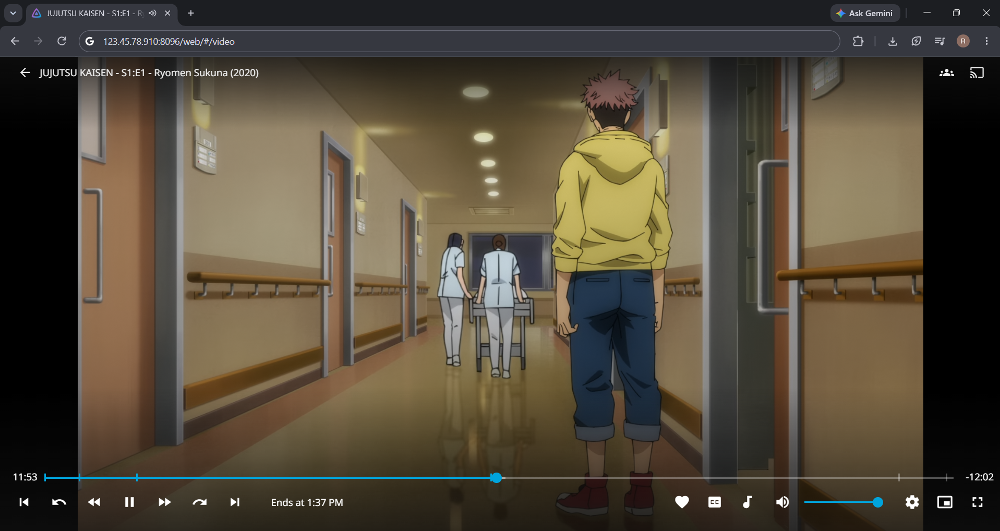
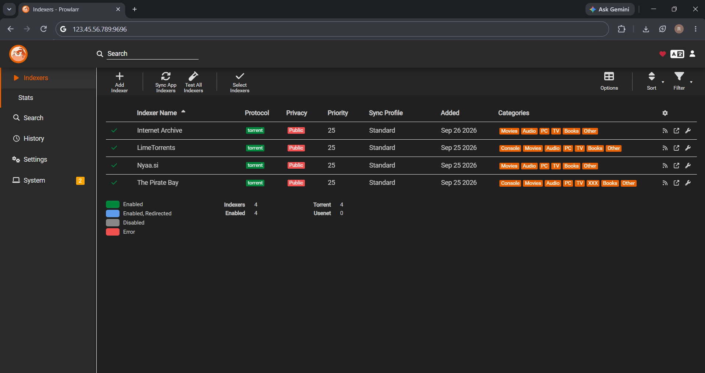
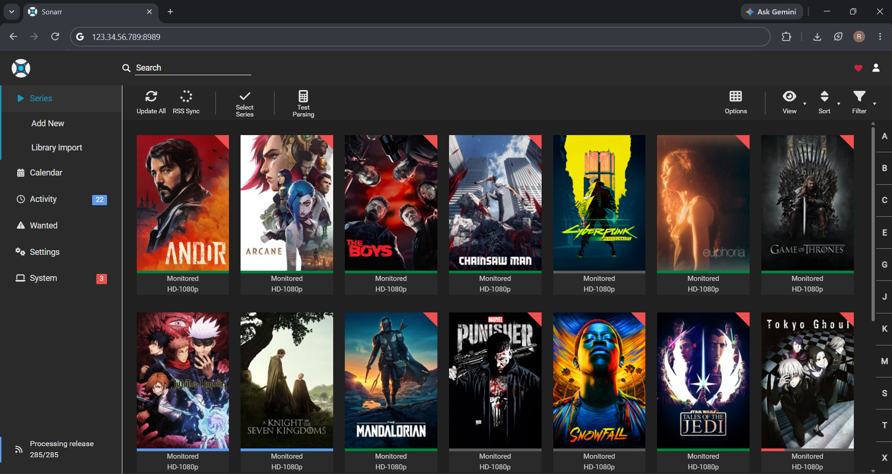
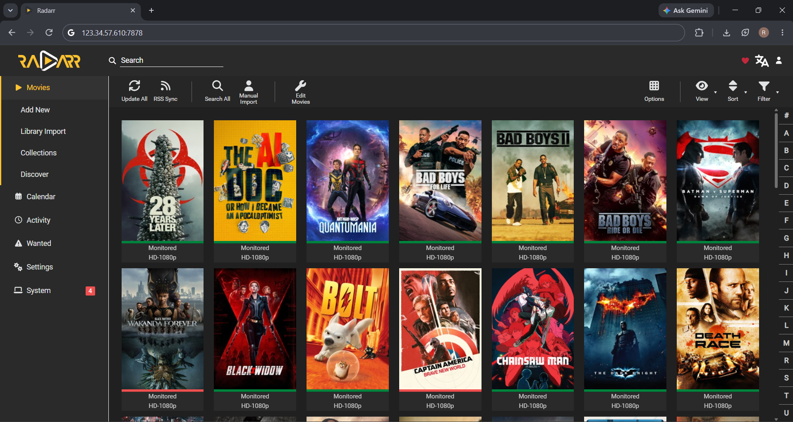

# Debian-Automated-Home-Server
Self-hosted media management and network infrastructure built using Debian Linux and Docker.

Project Overview

Designed and configured a home server to centralize media storage, automate media organization, provide remote connectivity, and host network services.

Technology Stack:
Debian Linux,
Docker,
Docker Compose,
Jellyfin,
Sonarr,
Radarr,
Prowlarr,
Tailscale,
Pi-hole,
Gluetun

Key Features
- Centralized media streaming with Jellyfin
- Automated media management and organization
- Containerized application deployment with Docker
- Remote access through Tailscale
- Network-wide DNS filtering with Pi-hole
- VPN networking configuration using Gluetun

## System Architecture

The home server runs Debian Linux with Docker Compose
to manage containerized applications for media automation.

The architecture integrates Jellyfin, Sonarr, Radarr,
Prowlarr, Bazarr, qBittorrent, Seerr, and Gluetun.

Server running on OptiPlex 7040

## Jellyfin

## Movie Page

## Seerr

## Movie Request Page

## Prowlarr

## Sonarr

## Radarr

## qBittorrent

